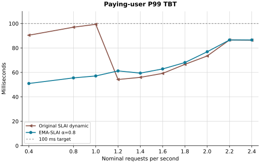

# Revisiting SLAI

Deyi Wang, Network Systems Lab, College of Computing and Data Science, Nanyang Technological University.

This repository accompanies *Revisiting SLAI: Cross-Architecture Performance Analysis and Adaptive Criticality Estimation for LLM Inference*. We reproduce the scheduling trends reported on RTX 6000 Ada and test one change on RTX PRO 6000 Blackwell Max-Q: give recent GPU batches more weight when deciding which decode requests are urgent. At 1.0 request/s, this change reduced paying-user P99 time between tokens from 99.36 to 57.10 ms.

## Problem: when does a decode become urgent?

Prefill produces a request's first token; decode produces each subsequent token. Both compete for the same GPU. SLAI uses each user's time-between-tokens (TBT) objective to decide how long decode can wait while prefill runs. To make room before the next token is due, SLAI subtracts an offset times the estimated batch duration from the token deadline.

Two Blackwell measurements explain why the timing matters. First, the original estimator gives equal weight to every batch since startup. When batches get longer, earlier short batches keep the estimate low and paying-user decodes can become urgent too late. Second, the offset responds to KV-cache occupancy. At 2.4 requests/s, active decodes reached the configured limit of 128 while peak KV-pool occupancy was 68.8%, below the 96% switch threshold. As requests accumulated, the offset stayed at 5, so the estimate determined how early the scheduler gave decode priority.

## Algorithm: update the estimate after each batch

EMA-SLAI initializes the estimate with the first measured batch duration. After each subsequent batch of duration $t_k$, it updates the estimate as

$$
\hat{t}_k = \alpha\hat{t}_{k-1}+(1-\alpha)t_k, \qquad \alpha=0.8.
$$

The newest batch gets 20% of the weight; each older observation's weight decays with every update. When recent batches take longer, the scheduler moves the urgency threshold earlier. When they get shorter, it leaves more time for prefill. The offset rule, shortest-prompt-first ordering, token budget and batch construction are shared with SLAI. The runtime variable `EMA_SLAI_RHO` sets the paper's $\alpha$. [Scheduler](SLAI-EMA/sarathi/core/scheduler/slai_scheduler.py) · [Algorithm patch](supplement/patches/ema-slai.patch)

## Performance on Blackwell

We compared the two estimators at ten arrival rates from 0.4 to 2.4 requests/s. Both used a 512-token budget and the same ShareGPT length trace, with TBT objectives of 100 ms for paying users and 500 ms for free users. The table shows four measured rates. Each pair is **original dynamic-offset SLAI → EMA-SLAI**, in milliseconds. The TTFT proxy is the first point at or above 50% in the exported time-to-first-token CDF for completed requests.

| Requests/s | Paying P99 TBT (ms) | Free P99 TBT (ms) | Median TTFT proxy (ms) |
| ---: | ---: | ---: | ---: |
| 0.8 | 97.00 → 55.52 | 122.33 → 140.72 | 198.72 → 204.31 |
| 1.0 | 99.36 → 57.10 | 242.93 → 264.21 | 216.55 → 219.01 |
| 1.4 | 55.97 → 59.43 | 438.23 → 359.51 | 242.09 → 242.75 |
| 2.4 | 86.38 → 86.55 | 360.96 → 351.69 | 733.54 → 721.48 |

At the original policy's local peak (1.0 request/s), EMA reduced paying-user P99 TBT by **42.5%**. The benefit changed with load: at 1.4 requests/s, paying-user P99 TBT rose by 3.46 ms while free-user P99 TBT fell by 78.72 ms. Both policies met both classes' P99 TBT objectives at all ten measured rates. The median TTFT proxy favored a different policy at different rates.



[All ten measurements (JSON)](supplement/results/blackwell.json) · [Free-user P99 TBT](supplement/results/free_p99_tbt.svg) · [Median TTFT proxy](supplement/results/ttft_median_proxy.svg)

## Future work

**Calibrate the scheduler for each GPU.** Measure KV capacity across context lengths and batch execution time across prefill/decode mixes. Use those profiles and each class's TBT target to choose the active-request limit, decodes per batch and token budget. Compare the calibrated settings with the original 128-request configuration on each GPU.

**Test deadline reservations under mixed service objectives.** PRESLA is a proposed extension: predict the duration of the current batch and a candidate next batch, then decide which decodes must run now, which need a place next round and which can wait. The next experiment is to compare those predictions with measured completion times and count deadline misses across three or more service classes.

## Source and reproduction

| Directory | Contents |
| --- | --- |
| [SLAI-original](SLAI-original/) | Original SLAI at commit `5098a7aba05e3edbcfa3a509d6cc9cd248fc4380`, including its schedulers, CUDA kernels, traces and benchmarks. |
| [SLAI-EMA](SLAI-EMA/) | Blackwell version with the EMA decode urgency estimator. |
| [supplement](supplement/) | Scheduler and runtime patches, benchmark launcher, run parameters and source checksums. |

The Blackwell build uses PyTorch 2.8.0 and loads the selected attention backend on demand. These changes affect the build configuration, package requirements and attention backend imports. [Runtime patch](supplement/patches/blackwell-runtime.patch)

## Benchmark

The experiments used Linux, Python 3.10, CUDA 12.8, PyTorch 2.8.0+cu128 and a Blackwell-compatible FlashAttention backend. Build the SLAI extensions in the GPU environment. Set `MODEL_DIR` to a local Mistral-7B-Instruct-v0.2 snapshot at revision `63a8b081895390a26e140280378bc85ec8bce07a`. The benchmark uses dummy model weights and the included ShareGPT length trace.

Run from the archive root:

```bash
ARCHIVE_ROOT="$PWD"
MODEL_DIR=/absolute/path/to/Mistral-7B-Instruct-v0.2
cd "$ARCHIVE_ROOT/SLAI-EMA"
python "$ARCHIVE_ROOT/supplement/examples/run_blackwell.py" --model-dir "$MODEL_DIR" --qps 1.0
```

For the cumulative-mean baseline, copy the Blackwell tree into a new directory and restore the original scheduler. This runs both policies with the same dependencies and request trace.

```bash
cd "$ARCHIVE_ROOT"
cp -R SLAI-EMA ../SLAI-baseline-blackwell
cp SLAI-original/sarathi/core/scheduler/slai_scheduler.py ../SLAI-baseline-blackwell/sarathi/core/scheduler/slai_scheduler.py
cd ../SLAI-baseline-blackwell
python "$ARCHIVE_ROOT/supplement/examples/run_blackwell.py" --model-dir "$MODEL_DIR" --qps 1.0 --out-dir results/baseline-q1
```

`--print-command` displays the benchmark command. [Experiment settings](supplement/provenance.json) · [Source checksums](supplement/source-trees.json)

## Credit

The original SLAI implementation accompanies *Optimal Scheduling Algorithms for LLM Inference: Theory and Practice* by Agrim Bari, Parikshit Hegde and Gustavo de Veciana. SLAI builds on Sarathi-Serve. Deyi Wang contributed the EMA scheduler modification and the Blackwell evaluation. [Original paper](https://users.ece.utexas.edu/~gustavo/papers/BHD25j.pdf) · [Upstream source](https://github.com/agrimUT/SLAI/tree/5098a7aba05e3edbcfa3a509d6cc9cd248fc4380) · [Apache 2.0 license](LICENSE)
